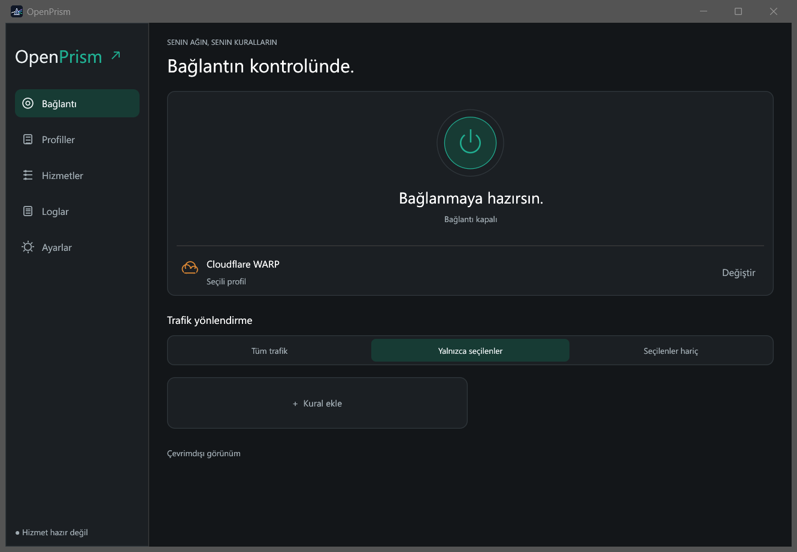

# OpenPrism


[English](README.md) · [Türkçe](README.tr.md) · [Русский](README.ru.md) · [简体中文](README.zh-CN.md)

OpenPrism routes chosen Windows applications through WireGuard, Cloudflare WARP, ByeDPI or Zapret. It is for keeping connection rules in one place, without changing the network settings of applications you leave out.



## Features

- WireGuard/WARP, ByeDPI and Zapret connection methods.
- Application include/exclude rules with priority for exclusions.
- Separate DPI profiles, staged GoodCheck scans and sanitized diagnostic export.
- Selective engine installation and shared service lifecycle.

## How routing works

A protected Windows service owns the connection. ProxiFyre classifies application traffic before forwarding it to a local SOCKS endpoint. WireGuard/WARP use sing-box behind that endpoint; ByeDPI uses its local proxy; Zapret uses an IPv4 relay with a confined WinDivert filter. The current runtime creates no system-wide TUN, changes no native DNS settings and adds no native routes.

Use application folders for include/exclude rules. Folder exclusions take priority over includes. DNS and local-network traffic stay native. This deliberately avoids forcing shared Windows DNS through a tunnel on behalf of unrelated applications. An application needing encrypted DNS should configure it itself.

## Install

Windows x64, .NET Framework 4.7.2 or newer, the x64 Visual C++ runtime and the official Windows Packet Filter driver are prerequisites for application capture. Driver installation may need a reboot. An existing shared driver is preserved.

- Portable development build: keep `WGTun.exe` beside its `backend` folder, then follow the first-run setup. The executable and internal service retain their old names for compatibility.
- Registered installation: run the package's `install-openprism.ps1`. Choose `-SelectedComponent core`, `byedpi` or `zapret`; only the requested optional engine is installed. Unsigned local packages require the explicit `-DevelopmentPackage` switch.
- Source build: install Rust with the MSVC toolchain, the Windows SDK and .NET 10 SDK, then run `powershell -ExecutionPolicy Bypass -File scripts/build-native.ps1`.

Core engine downloads are pinned and hash-verified. Initial setup needs administrator approval; connecting, disconnecting, scanning strategies and reading logs use authenticated service IPC. Optional engines have separate install/remove controls. Core components are removed together from Services. Windows Settings uninstall also removes recognized application data and the app's own service/firewall registrations.

For official prerequisite deployment, see [ProxiFyre's installation documentation](https://github.com/wiresock/proxifyre/blob/v2.7.0/docs/installer.md) and [Windows Packet Filter](https://github.com/wiresock/ndisapi). Do not install a second standalone ProxiFyre service for OpenPrism.

## Strategies

Both DPI engines have separate saved profiles. Turkish carrier candidates include Türk Telekom, Kablonet, Superonline, Turkcell and Vodafone; their names reflect upstream reports, not a promise that they work on your connection. Provenance, adaptations and licenses are in [StrategySources.md](src/WGTun.Core/StrategySources.md).

GoodCheck explores the fixed candidates, retests the best four and reports each host's outcome and elapsed time. It is bounded and cancellable. It measures certificate-validated HTTPS TCP; it does not certify DNS, UDP, QUIC, streaming or an entire ISP.

## Diagnostics

Settings can export a diagnostic JSON report. It contains component state and version information, with no keys, application paths, target hosts or raw logs. Crash records retain event names and exception types. Detailed engine logs can contain connection metadata; they are not included in the export.

## Limits worth knowing

- This is an experimental build. No application kill switch or leak-proof security boundary is claimed.
- Native capture currently supports application folders and executable-name includes. Destination IP rules, executable-path rules and protocol-specific/name-substring exclusions are rejected instead of silently falling back to a system-wide TUN. Use an application folder for exclusions.
- ByeDPI and Zapret captures are IPv4-only; matched IPv6 traffic is blocked so applications can fall back to IPv4. Unmatched IPv6 remains native. WireGuard IPv6 depends on the supplied profile and still needs broader packet-level validation.
- Process attribution, fragmented packets, existing connections, security products and driver conflicts can limit capture. Restart affected application connections after changing rules.
- A running engine does not establish that a website or stream is reachable. HTTPS connectivity was tested; streaming playback has not been tested.
- Signed paired release/update tooling exists, but no publisher certificate is supplied and no signed release has been produced. Development builds refuse automatic signed updates without a configured trusted publisher.
- Updates retain the previous application directory for rollback. Modified or foreign files are preserved during cleanup and may need manual inspection.

## Antivirus and alternative installation choices

WinDivert is a legitimate packet-processing driver, but antivirus products can flag it or applications using it. The [upstream FAQ](https://reqrypt.org/windivert-faq.html) discusses this. A warning should be investigated using the exact artifact, signature and pinned hash; do not disable antivirus globally or download a repack from an unrelated site. If Zapret is blocked, leave it uninstalled and use WireGuard/WARP or ByeDPI. The native capture driver has its own prerequisites and trust checks.

## Development and verification

Run the core checks, capture admission/configuration checks, dependency checks and native tests:

```powershell
dotnet run --project tests/WGTun.Checks
dotnet run --project tests/WGTun.CaptureBoundary
dotnet run --project src/WGTun.Core/Tests/WGTun.DependencyChecks.csproj
cargo test --manifest-path src/WGTun.Native/Cargo.toml
python scripts/test-installation.py
```

The installation test uses temporary fixtures and never installs a driver or service. Live capture checks require the explicitly approved [maintenance runner](scripts/admin-runner.ps1). See [verification](docs/current-verification.md), [capture boundary](docs/capture-boundary.md) and [installation](docs/installation.md).

## Licenses and credits

Third-party engines keep their own licenses. ProxiFyre is an external AGPL-3.0 executable, with source at [v2.7.0](https://github.com/wiresock/proxifyre/tree/v2.7.0); it is downloaded unmodified. Notices are under [dependencies/notices](dependencies/notices). The original prism mark is CC0.
