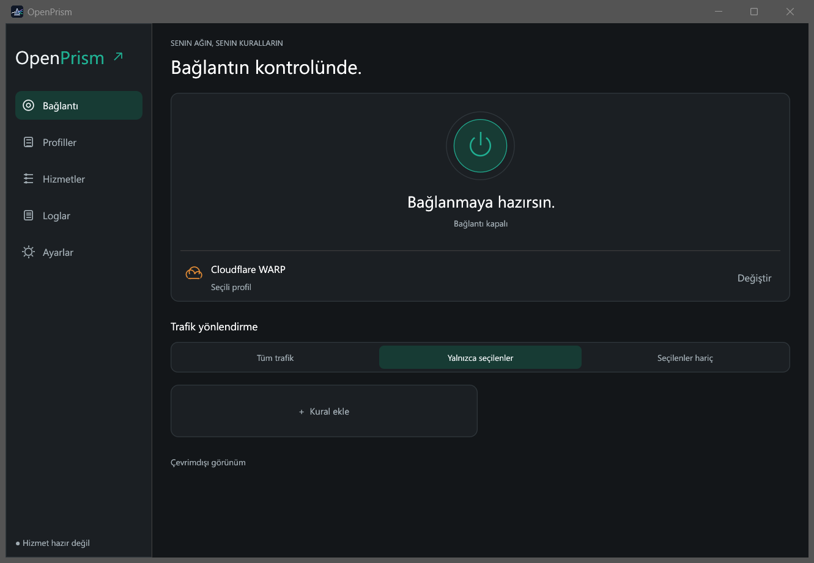

# OpenPrism

 

[English](README.md) · [Türkçe](README.tr.md) · [Русский](README.ru.md) · [简体中文](README.zh-CN.md)

OpenPrism направляет выбранные приложения Windows через WireGuard, Cloudflare WARP, ByeDPI или Zapret. Правила исключения имеют приоритет. Для исключений используйте папку приложения.

## Маршрутизация и установка

ProxiFyre передаёт подходящий трафик локальному SOCKS-прокси. Новая схема не создаёт системный TUN, не меняет маршруты и настройки DNS Windows. DNS и локальная сеть остаются прямыми. Нужны Windows x64, .NET Framework 4.7.2+, Visual C++ x64 и официальный драйвер Windows Packet Filter. Общий существующий драйвер при удалении сохраняется. [Установка](README.md#install).

## Профили и диагностика

При первом запуске устанавливается только выбранный дополнительный движок. ByeDPI и Zapret имеют независимые профили. GoodCheck проверяет кандидатов и повторно тестирует четыре лучших варианта; результаты относятся только к HTTPS/TCP. Экспорт диагностики не содержит ключей, путей приложений или исходных журналов.

## Ограничения

Версия экспериментальная. Потоковое воспроизведение не тестировалось. Правила по IP назначения, пути отдельного exe и исключения только одного протокола не поддерживаются. Автоматического перехода на системный TUN нет. ByeDPI/Zapret ограничены IPv4; IPv6 выбранных приложений блокируется для перехода на IPv4, остальной IPv6 остаётся прямым. Полная проверка WireGuard IPv6 ещё необходима. Kill switch и отсутствие утечек не гарантируются.

## Антивирус и альтернативы

Антивирус может отмечать WinDivert. Проверьте [официальный FAQ](https://reqrypt.org/windivert-faq.html), источник, подпись и хеш файла. Не отключайте защиту целиком. Вместо Zapret можно выбрать WireGuard/WARP или ByeDPI. [Официальные зависимости](https://github.com/wiresock/proxifyre/blob/v2.7.0/docs/installer.md).

## Обновление и удаление

Инструменты подписанной парной сборки и обновления готовы, но сертификата издателя и подписанного выпуска пока нет. Удаление сохраняет общие драйверы и неизвестные либо изменённые файлы. Предыдущая папка приложения сохраняется для отката обновления.

[Ограничения и проверка](README.md#limits-worth-knowing) · [Источники стратегий](src/WGTun.Core/StrategySources.md)
