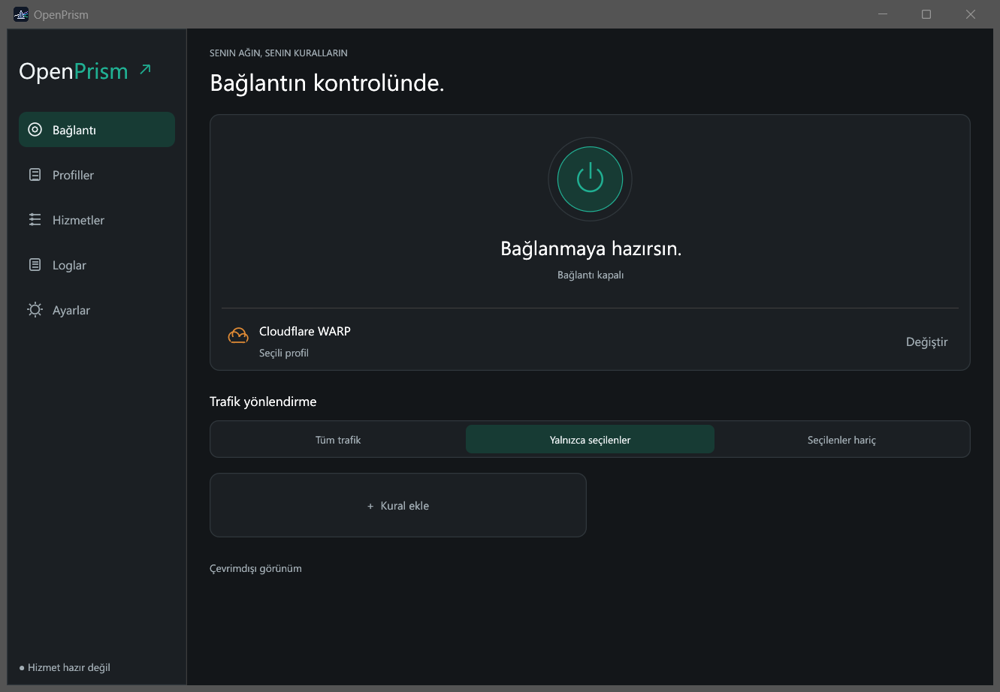

# OpenPrism

 

[Türkçe](README.tr.md) · [English](README.md) · [Русский](README.ru.md) · [简体中文](README.zh-CN.md)

OpenPrism, seçtiğin Windows uygulamalarını WireGuard, Cloudflare WARP, ByeDPI veya Zapret üzerinden yönlendirir. Dışarıda bıraktığın uygulamaların DNS ve ağ ayarlarını değiştirmemeyi amaçlar.

## Trafik yönlendirme

Uygulama klasörlerini dahil edebilir veya hariç tutabilirsin. Hariç tutma kuralları önceliklidir. Windows hizmeti, ProxiFyre ile uygulama trafiğini yerel SOCKS çıkışına aktarır. Çalışan yeni altyapı sistem genelinde TUN açmaz, DNS ayarı veya rota değiştirmez. DNS ve yerel ağ bağlantıları doğal yollarında kalır.

## Kurulum

Windows x64, .NET Framework 4.7.2+, Visual C++ x64 çalışma zamanı ve resmi Windows Packet Filter sürücüsü gerekir. Mevcut ortak sürücü kaldırılmaz. Taşınabilir pakette WGTun.exe ile backend klasörünü birlikte tut; ilk kurulumda istediğin yöntemi seç. Yalnızca seçilen isteğe bağlı motor indirilir. Kayıtlı kurulum için install-openprism.ps1 kullanılabilir; imzasız geliştirme paketi açıkça DevelopmentPackage seçeneğini gerektirir. [İngilizce kurulum ayrıntıları](README.md#install).

## Profiller ve tanılama

ByeDPI ve Zapret profilleri ayrıdır. İSS önayarları upstream adaylarıdır, çalışma garantisi değildir. GoodCheck bütün adayları dener, en iyi dört adayı yeniden sınar ve hedef bazında sonuç verir. Yalnızca HTTPS/TCP ölçülür; UDP, QUIC veya yayın oynatma testi yapılmış sayılmaz. Ayarlardaki tanılama raporu anahtarları, uygulama yollarını ve ham logları içermez.

## Kısıtlamalar

Bu sürüm deneyseldir. Yayın/stream testi yapılmamıştır. IP hedef kuralları, tek çalıştırılabilir dosya yolu ve protokole özel hariç tutmalar şu an desteklenmez; sistem geneli TUN'a sessizce geçilmez. Hariç tutmak için uygulama klasörü kullan. ByeDPI/Zapret IPv4 ile sınırlıdır; seçilen IPv6 engellenir, seçilmeyen IPv6 doğal yolunda kalır. WireGuard IPv6 için daha fazla test gerekir. Kill switch veya sızıntısız güvenlik sınırı vaadi yoktur.

## Antivirüs ve alternatifler

WinDivert antivirüs uyarısı verebilir; [resmi açıklamayı](https://reqrypt.org/windivert-faq.html), dosyanın kaynağını, imzasını ve sabit hash'ini kontrol et. Antivirüsü tamamen kapatma. Zapret engelleniyorsa kurmadan WireGuard/WARP veya ByeDPI seçebilirsin. Sürücü önkoşulları için [resmi kurulum belgesine](https://github.com/wiresock/proxifyre/blob/v2.7.0/docs/installer.md) bak.

## Güncelleme ve kaldırma

İmzalı uygulama/hizmet güncelleme altyapısı hazırlanmıştır; yayıncı sertifikası ve gerçek imzalı sürüm henüz yoktur. Windows üzerinden kaldırma, tanınan uygulama dosyalarını ve kendi hizmet/güvenlik duvarı kayıtlarını temizler; ortak sürücülere ve yabancı/değiştirilmiş dosyalara dokunmaz. Güncellemelerde eski klasör geri dönüş için tutulur.

[Tüm kısıtlamalar ve testler](README.md#limits-worth-knowing) · [Önayar kaynakları](src/WGTun.Core/StrategySources.md)
