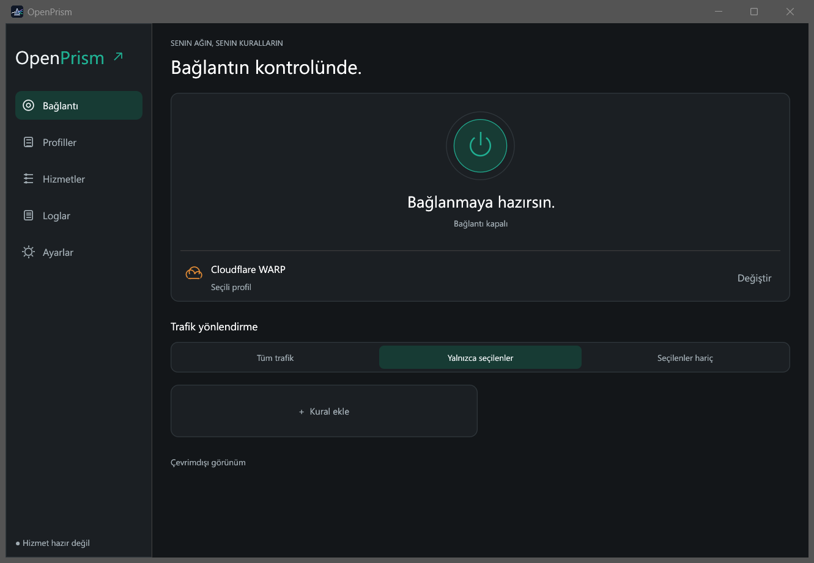

# OpenPrism

 

[English](README.md) · [Türkçe](README.tr.md) · [Русский](README.ru.md) · [简体中文](README.zh-CN.md)

OpenPrism 将所选 Windows 应用的流量转发至 WireGuard、Cloudflare WARP、ByeDPI 或 Zapret。排除规则优先；排除应用时请使用应用文件夹。

## 路由与安装

ProxiFyre 在转发至本地 SOCKS 代理前匹配应用。新运行路径不创建全局 TUN，也不更改 Windows 路由或 DNS 设置。DNS 与局域网连接保持直连。需要 Windows x64、.NET Framework 4.7.2+、Visual C++ x64 运行库和官方 Windows Packet Filter 驱动。卸载时保留已有共享驱动。[安装说明](README.md#install)。

## 配置与诊断

首次安装仅下载所选的可选引擎。ByeDPI 与 Zapret 的配置独立保存。GoodCheck 测试候选策略，再复测最佳四项，并显示各目标的结果；这些结果仅代表 HTTPS/TCP，不代表 UDP、QUIC 或视频播放验证。诊断导出不包含密钥、应用路径或原始日志。

## 限制

目前为实验版本。尚未进行流媒体播放测试。暂不支持目标 IP 规则、单个 exe 完整路径规则，以及仅排除某一种协议的规则；不会静默切换至全局 TUN。ByeDPI/Zapret 仅支持 IPv4，所选应用的 IPv6 会被阻止以便回退到 IPv4，未匹配的 IPv6 保持原样。WireGuard IPv6 仍需进一步验证。不承诺 kill switch 或完全无泄漏。

## 杀毒软件与替代选项

杀毒软件可能对 WinDivert 发出警报。请检查[官方 FAQ](https://reqrypt.org/windivert-faq.html)、文件来源、签名和固定哈希，不要全局关闭杀毒软件。若 Zapret 被阻止，可选择 WireGuard/WARP 或 ByeDPI。[官方依赖说明](https://github.com/wiresock/proxifyre/blob/v2.7.0/docs/installer.md)。

## 更新与卸载

已有应用和服务配套签名更新工具，但尚未提供发布者证书，也未生成真正签名的发行版。卸载保留共享驱动及未知或被修改的文件。更新会保留旧目录供回滚。

[完整限制与测试](README.md#limits-worth-knowing) · [策略来源](src/WGTun.Core/StrategySources.md)
